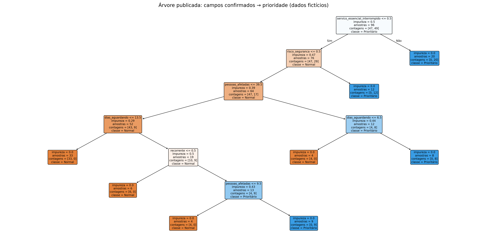
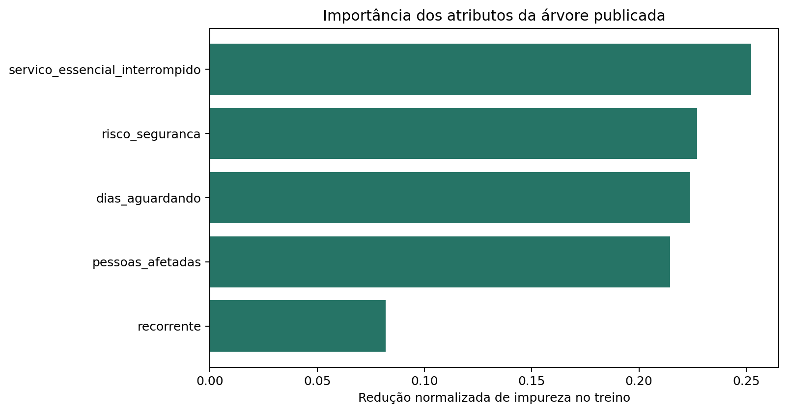
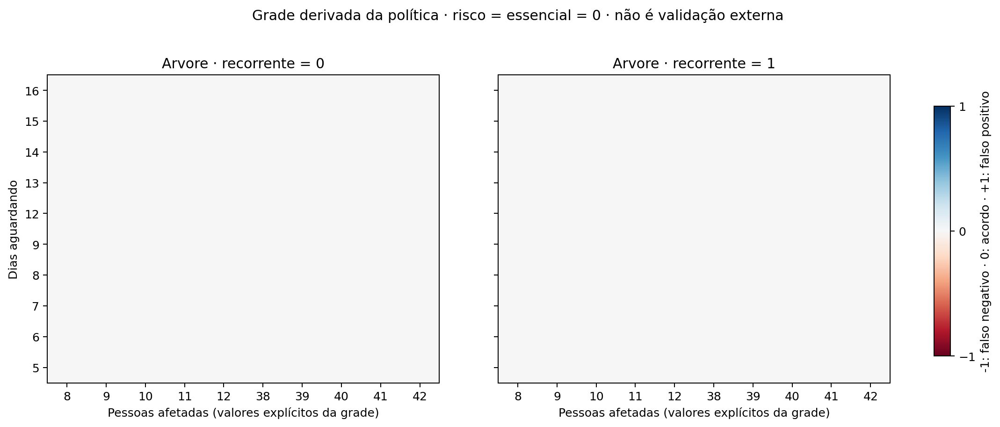
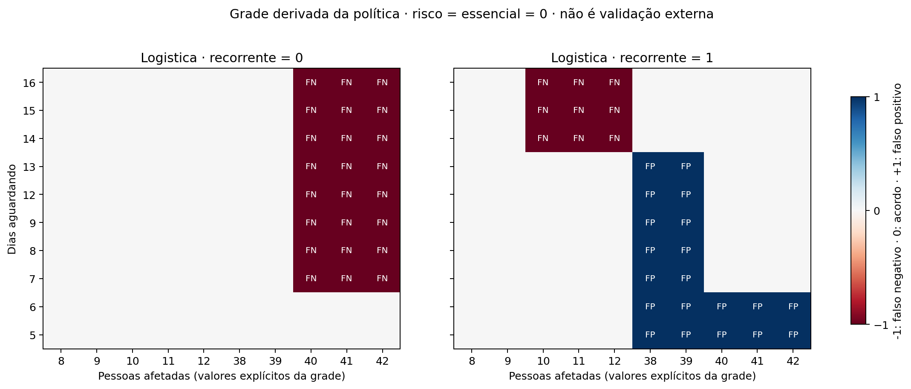
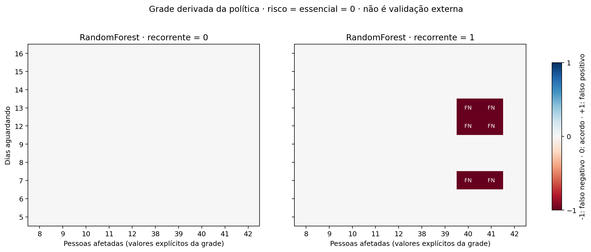
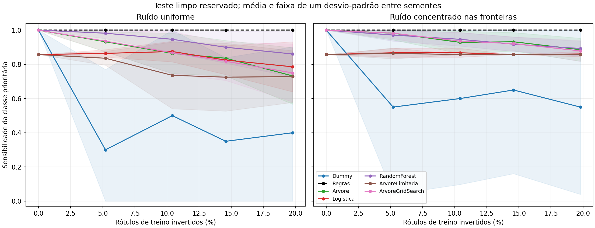
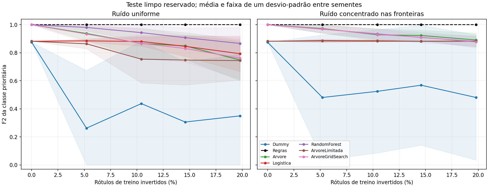
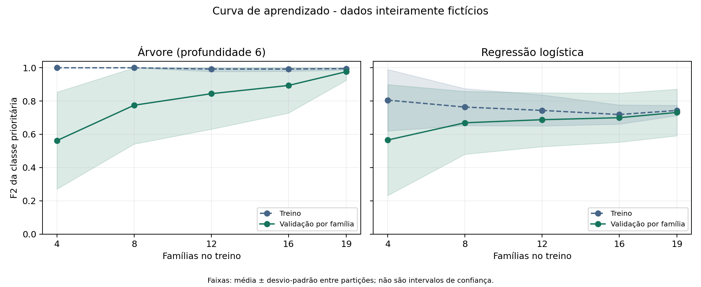
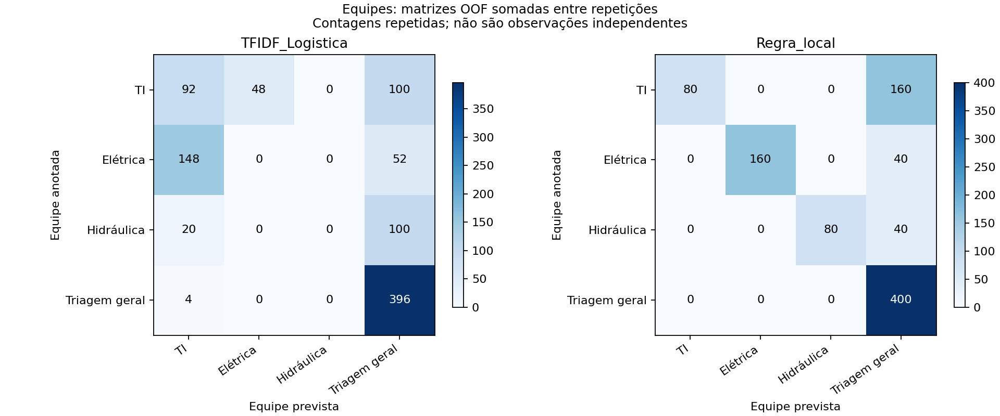

# Relatório acadêmico de Inteligência Artificial

**Sistema Inteligente para Priorização de Chamados de Manutenção**

**Engenharia de Computação · Integrante único: Guilherme Costa**

## 1. Problema, hipótese e papel do ML

O protótipo apoia a triagem de manutenção por uma pessoa. A prioridade usa cinco campos confirmados; o experimento textual sugere equipe a partir da descrição. Toda a base é fictícia e a foto não entra em nenhum dos modelos treinados aqui.

A prioridade foi rotulada por uma política determinística conhecida. Nesse contexto, regras explícitas são uma solução suficiente e mais direta: os resultados não justificam substituir regras estáveis por ML. O objetivo acadêmico dos modelos aprendidos é estudar generalização entre famílias, incerteza, erros, sensibilidade a ruído e limites de aprender a partir de poucos exemplos. Uma aplicação operacional exigiria rótulos reais independentes, especialistas e avaliação prospectiva.

## 2. Dados, política e separação

O desenvolvimento contém 96 registros em 24 famílias; os 24 registros de 6 famílias reservadas permanecem separados. A divisão original é a primeira partição do StratifiedGroupKFold com embaralhamento e semente 42. O reservado já havia sido consultado no protótipo; seu uso agora é continuidade e exploração, não nova confirmação independente.

X = risco_seguranca, servico_essencial_interrompido, pessoas_afetadas, dias_aguardando e recorrente; y = prioridade. A política dá classe 1 por risco ou serviço essencial interrompido, ou por pessoas >= 40 e dias >= 7, ou por recorrência com pessoas >= 10 e dias >= 14. Os demais casos recebem classe 0.

As colunas equipe_rotulo e equipe_justificativa foram acrescentadas por anotação editorial didática de família. As colunas originais, os rótulos de prioridade e os artefatos do aplicativo foram preservados. A taxonomia e as justificativas estão em [rotulagem de equipes](../dados/rotulagem_equipes.md).

## 3. Baselines e validação agrupada repetida

Foram executadas 10 repetições com sementes distintas, cada uma com cinco folds somente no desenvolvimento. Todas as variações de uma família permanecem juntas. A padronização da regressão logística é ajustada exclusivamente no treino de cada fold. A árvore usa profundidade máxima 6 e semente 42; os hiperparâmetros dos demais modelos são fixos e estão no JSON. A comparação não é uma nova seleção aninhada da profundidade escolhida no protótipo.

A tabela mostra média ± desvio-padrão amostral das métricas OOF agregadas por repetição. Sensibilidade, precisão, F1 e F2 referem-se à classe prioritária; acurácia é global. F2 dá peso maior à sensibilidade. Divisões por zero recebem zero, documentadas no código.

| Modelo | Sensibilidade | Precisão | F1 | F2 | Acurácia |
| --- | --- | --- | --- | --- | --- |
| Dummy maioria | 0,5510 ± 0,0000 | 0,4500 ± 0,0000 | 0,4954 ± 0,0000 | 0,5273 ± 0,0000 | 0,4271 ± 0,0000 |
| Política explícita | 1,0000 ± 0,0000 | 1,0000 ± 0,0000 | 1,0000 ± 0,0000 | 1,0000 ± 0,0000 | 1,0000 ± 0,0000 |
| Árvore atual | 0,9816 ± 0,0244 | 0,9628 ± 0,0278 | 0,9718 ± 0,0170 | 0,9776 ± 0,0194 | 0,9708 ± 0,0176 |
| Regressão logística | 0,7082 ± 0,0099 | 0,9285 ± 0,0233 | 0,8033 ± 0,0079 | 0,7433 ± 0,0077 | 0,8229 ± 0,0085 |
| Random forest | 1,0000 ± 0,0000 | 0,9705 ± 0,0138 | 0,9850 ± 0,0070 | 0,9939 ± 0,0029 | 0,9844 ± 0,0074 |

Intervalos de confiança percentis de 95%: bootstrap de famílias inteiras, mantendo juntas todas as variações e repetições, com 1000 reamostragens. A estatística reamostrada é a média das métricas OOF por repetição. Não se tratam os folds nem as repetições sobrepostas como novas observações independentes.

| Modelo | sensibilidade | precisao | f1 | f2 | acuracia |
| --- | --- | --- | --- | --- | --- |
| Dummy maioria | [0,4450; 0,6679] | [0,2825; 0,6206] | [0,3561; 0,6013] | [0,4117; 0,6191] | [0,3521; 0,5042] |
| Política explícita | [1,0000; 1,0000] | [1,0000; 1,0000] | [1,0000; 1,0000] | [1,0000; 1,0000] | [1,0000; 1,0000] |
| Árvore atual | [0,9588; 0,9958] | [0,9228; 0,9874] | [0,9446; 0,9885] | [0,9551; 0,9918] | [0,9531; 0,9854] |
| Regressão logística | [0,4635; 0,8810] | [0,8184; 1,0000] | [0,6025; 0,9154] | [0,5126; 0,8922] | [0,7208; 0,9167] |
| Random forest | [1,0000; 1,0000] | [0,9242; 1,0000] | [0,9603; 1,0000] | [0,9836; 1,0000] | [0,9625; 1,0000] |

Os intervalos são condicionais às famílias sintéticas observadas; não incluem toda a incerteza de geração, rotulagem e mudança de instituição. Um intervalo [1;1] para regras não prova segurança em dados reais.

### Teste reservado para continuidade

| Modelo | Sensibilidade | Precisão | F1 | F2 | Acurácia |
| --- | --- | --- | --- | --- | --- |
| Dummy maioria | 1,0000 | 0,5833 | 0,7368 | 0,8750 | 0,5833 |
| Política explícita | 1,0000 | 1,0000 | 1,0000 | 1,0000 | 1,0000 |
| Árvore atual | 1,0000 | 1,0000 | 1,0000 | 1,0000 | 1,0000 |
| Regressão logística | 0,8571 | 1,0000 | 0,9231 | 0,8824 | 0,9167 |
| Random forest | 1,0000 | 1,0000 | 1,0000 | 1,0000 | 1,0000 |

Fonte: [comparacao_modelos.json](../relatorios/comparacao_modelos.json). A árvore no reservado é o estimador original; na CV são ajustadas novas árvores com a mesma configuração, em treinos menores.

## 4. Interpretabilidade da árvore preservada

A árvore possui profundidade 6, 15 nós e foi ajustada nos 96 registros originais de treino. Os cortes recuperam a política neste domínio inteiro.

| Campo | Corte aprendido | Primeiro inteiro à direita | Equivalente |
| --- | --- | --- | --- |
| servico_essencial_interrompido | 0.5 | 1 | Sim |
| risco_seguranca | 0.5 | 1 | Sim |
| pessoas_afetadas | 39.5 | 40 | Sim |
| dias_aguardando | 13.5 | 14 | Sim |
| recorrente | 0.5 | 1 | Sim |
| pessoas_afetadas | 9.5 | 10 | Sim |
| dias_aguardando | 6.5 | 7 | Sim |

Os cortes intermediários entre inteiros consecutivos são numericamente diferentes dos limiares escritos, mas representam a mesma decisão. Em outras amostras pequenas, cortes equivalentes sobre os pontos observados podem divergir em regiões não cobertas; por isso a análise de fronteiras e OOF é necessária. Importância por redução de impureza descreve esta árvore, sem interpretação causal e sem medir relevância universal.

Fonte: [interpretabilidade.json](../relatorios/interpretabilidade.json), export_text e limiares_arvore.csv.

## 5. Fronteiras e análise de erros

A grade contém 800 combinações únicas: os dois blocos de pessoas e de dias ao redor dos limiares, cruzados com risco, essencial e recorrência binários. É uma verificação de consistência derivada da própria política, não validação externa.

| Modelo | Divergências | FN | FP | FN/positivos |
| --- | --- | --- | --- | --- |
| Dummy maioria | 137 | 0 | 137 | 0,0000 |
| Política explícita | 0 | 0 | 0 | 0,0000 |
| Árvore atual | 0 | 0 | 0 | 0,0000 |
| Regressão logística | 53 | 33 | 20 | 0,0498 |
| Random forest | 6 | 6 | 0 | 0,0090 |

As taxas por região, com denominadores e ausência de positivos identificada como nulo, estão em [falsos_negativos_regioes.csv](../relatorios/falsos_negativos_regioes.csv). A ausência de divergência da árvore publicada nessa grade não implica que árvores treinadas em outros subconjuntos recuperem todos os cortes.

### Erros OOF mesmo com teste reservado perfeito

| Modelo | Ocorrências erradas | Falsos negativos |
| --- | --- | --- |
| Dummy maioria | 550 | 220 |
| Política explícita | 0 | 0 |
| Árvore atual | 28 | 9 |
| Regressão logística | 170 | 143 |
| Random forest | 15 | 0 |

Ocorrências incluem o mesmo ID em repetições diferentes, portanto não são quantidade de chamados independentes. A lista integral contém ID, família, seed, fold, campos, classe real e prevista em [erros_oof_modelos.csv](../relatorios/erros_oof_modelos.csv). Exemplos medidos da árvore:

| ID | Família | Real | Previsto | Erro |
| --- | --- | --- | --- | --- |
| FIC-051 | som_auditorio | 1 | 0 | falso_negativo |
| FIC-116 | acustica_oficina | 1 | 0 | falso_negativo |
| FIC-118 | computadores_auxiliares | 1 | 0 | falso_negativo |
| FIC-047 | laboratorio_tomadas | 0 | 1 | falso_positivo |
| FIC-115 | acustica_oficina | 0 | 1 | falso_positivo |
| FIC-012 | lampada_deposito | 0 | 1 | falso_positivo |
| FIC-053 | banheiro_recorrente | 0 | 1 | falso_positivo |
| FIC-024 | persiana_reuniao | 0 | 1 | falso_positivo |

## 6. Experimento de ruído de rótulos

A unidade de corrupção é o registro. Invertem-se apenas rótulos do treino, sem modificar X ou o teste limpo. Foram usadas 20 sementes de ruído, com taxas nominais 0%, 5%, 10%, 15%, 20%. A quantidade real é round(taxa × tamanho do treino), a mesma nos dois modos. O ruído de fronteira favorece pontos próximos à classe oposta segundo a política e protege casos com risco ou essencial. É uma hipótese artificial de desacordo, não medição de avaliadores reais.

São comparados os mesmos modelos, uma árvore de profundidade limitada a 3 e uma árvore com GridSearch em profundidades 1 a 6 ou sem limite, usando quatro folds agrupados de treino ruidoso e F2. O teste limpo é reutilizado para explorar os efeitos, sem selecionar a árvore do aplicativo.

Resumo na maior taxa nominal avaliada; média ± desvio-padrão entre sementes:

| Ruído | Modelo | F2 teste limpo | Sensibilidade teste | F2 treino ruidoso |
| --- | --- | --- | --- | --- |
| uniforme | Dummy maioria | 0,3500 ± 0,4398 | 0,4000 ± 0,5026 | 0,3410 ± 0,4285 |
| uniforme | Política explícita | 1,0000 ± 0,0000 | 1,0000 ± 0,0000 | 0,8098 ± 0,0115 |
| uniforme | Árvore atual | 0,7480 ± 0,1470 | 0,7321 ± 0,1653 | 0,8706 ± 0,0573 |
| uniforme | Regressão logística | 0,7933 ± 0,1266 | 0,7857 ± 0,1466 | 0,5977 ± 0,0820 |
| uniforme | Random forest | 0,8664 ± 0,1143 | 0,8607 ± 0,1341 | 0,9783 ± 0,0166 |
| uniforme | Árvore limitada | 0,7443 ± 0,1387 | 0,7286 ± 0,1513 | 0,6521 ± 0,0926 |
| uniforme | Árvore com GridSearch | 0,7614 ± 0,1495 | 0,7500 ± 0,1695 | 0,9349 ± 0,0694 |
| fronteira | Dummy maioria | 0,4813 ± 0,4466 | 0,5500 ± 0,5104 | 0,4732 ± 0,4393 |
| fronteira | Política explícita | 1,0000 ± 0,0000 | 1,0000 ± 0,0000 | 0,8023 ± 0,0101 |
| fronteira | Árvore atual | 0,8913 ± 0,0497 | 0,8857 ± 0,0672 | 0,8774 ± 0,0443 |
| fronteira | Regressão logística | 0,8834 ± 0,0046 | 0,8607 ± 0,0160 | 0,7547 ± 0,0360 |
| fronteira | Random forest | 0,8807 ± 0,0343 | 0,8929 ± 0,0434 | 0,9706 ± 0,0151 |
| fronteira | Árvore limitada | 0,8824 ± 0,0000 | 0,8571 ± 0,0000 | 0,7860 ± 0,0774 |
| fronteira | Árvore com GridSearch | 0,8773 ± 0,0435 | 0,8786 ± 0,0618 | 0,8979 ± 0,0800 |

A diferença entre desempenho no treino ruidoso e no teste limpo e a frequência de profundidades selecionadas permitem discutir sobreajuste. Não se deve concluir que limitar a profundidade ou usar regressão logística sempre melhora a robustez; o resultado depende de como o erro de rótulo foi gerado. A regra explícita não aprende rótulos corrompidos e permanece uma referência favorecida pelo desenho do experimento.

GridSearch, uniforme: frequências de profundidade máxima escolhida = {"sem_limite": 14, "6": 3, "4": 1, "5": 2}. A escolha usou apenas o treino ruidoso; não foi aplicada ao modelo publicado.

GridSearch, fronteira: frequências de profundidade máxima escolhida = {"sem_limite": 8, "4": 2, "5": 3, "3": 4, "6": 3}. A escolha usou apenas o treino ruidoso; não foi aplicada ao modelo publicado.

Fonte: [experimento_ruido.json](../relatorios/experimento_ruido.json), com todas as sementes e posições invertidas.

## 7. Curva de aprendizado

Subconjuntos aninhados de famílias do treino externo são avaliados em famílias externas separadas, sem usar os exemplos reservados. O menor prefixo garante as duas classes usando apenas o treino externo.

| Modelo | Famílias | F2 treino | F2 validação | Sensibilidade validação |
| --- | --- | --- | --- | --- |
| Árvore atual | 4 | 1,0000 ± 0,0000 | 0,5624 ± 0,2913 | 0,5413 ± 0,3013 |
| Árvore atual | 8 | 1,0000 ± 0,0000 | 0,7748 ± 0,2333 | 0,7690 ± 0,2569 |
| Árvore atual | 12 | 0,9924 ± 0,0153 | 0,8441 ± 0,2135 | 0,8486 ± 0,2440 |
| Árvore atual | 16 | 0,9922 ± 0,0135 | 0,8935 ± 0,1659 | 0,8908 ± 0,1845 |
| Árvore atual | 19 | 0,9951 ± 0,0086 | 0,9763 ± 0,0513 | 0,9806 ± 0,0581 |
| Regressão logística | 4 | 0,8053 ± 0,1847 | 0,5656 ± 0,3336 | 0,5707 ± 0,3588 |
| Regressão logística | 8 | 0,7636 ± 0,1112 | 0,6692 ± 0,1891 | 0,6389 ± 0,2050 |
| Regressão logística | 12 | 0,7437 ± 0,0935 | 0,6877 ± 0,1620 | 0,6563 ± 0,1783 |
| Regressão logística | 16 | 0,7189 ± 0,0579 | 0,6997 ± 0,1473 | 0,6643 ± 0,1605 |
| Regressão logística | 19 | 0,7433 ± 0,0309 | 0,7313 ± 0,1401 | 0,6993 ± 0,1537 |

A melhora com mais famílias mede cobertura de cenários sintéticos. Não comprova que esta base seja suficiente para uso real: cada família repete uma descrição e os rótulos de prioridade já seguem uma regra conhecida. A regressão logística também tem limitação de representação de interações; aumentar a amostra não elimina automaticamente esse viés.

Fonte: [curva_aprendizado.json](../relatorios/curva_aprendizado.json).

## 8. Classificador textual de equipe

Pipeline treinado: limpeza do sufixo de variação, TF-IDF de palavras/unigramas e bigramas em união com n-gramas de caracteres de 3 a 5, seguido de regressão logística. O vocabulário e os pesos são ajustados somente no treino de cada fold. A prioridade, números de pessoas/dias gerados, foto, ID e família não entram no classificador.

| Método | Acurácia OOF | F1 macro OOF |
| --- | --- | --- |
| TFIDF_Logistica | 0,5083 ± 0,0473 | 0,2791 ± 0,0366 |
| Regra_local | 0,7500 ± 0,0000 | 0,7395 ± 0,0000 |

Critério anterior à integração: superar estritamente a regra local nas duas médias OOF. Regra local preservada; modelo textual permanece experimental.

O modelo textual ficou abaixo da regra local: não substituiu o comportamento do Flask. Seu artefato e os testes são entregues como experimento. A baixa generalização entre famílias é um resultado relevante, favorecido por pouca diversidade textual e poucas famílias por especialidade. Não foram geradas paráfrases extras nem misturadas variações no reservado.

As matrizes de confusão somam predições OOF repetidas, não novos registros independentes. A lista completa de erros e a matriz estão em [classificador_texto.json](../relatorios/classificador_texto.json) e classificador_texto_oof.csv. O teste reservado é mostrado separadamente e não decidiu a integração.

| Método | Acurácia reservada | F1 macro reservado |
| --- | --- | --- |
| TFIDF_Logistica | 0,3333 | 0,1429 |
| Regra_local | 1,0000 | 0,5000 |

O reservado foi estratificado por prioridade, não por equipe, e só contém Hidráulica e Triagem geral. O F1 macro usa as quatro classes fixas, atribuindo zero às classes ausentes. Portanto mesmo a regra que acerta todos os registros reservados não obtém F1 macro igual a um; não se deve comparar esse número diretamente à acurácia nem usá-lo para escolher o classificador textual.

## 9. Ameaças à validade

- **Circularidade:** o baseline de regras conhece o gerador dos rótulos. A grade deriva da mesma política. Consistência é diferente de validação externa.
- **Amostra pequena e dependente:** variações de uma família não são observações independentes. Separação por família, IC em blocos e OOF reduzem vazamento, sem criar diversidade real.
- **Incerteza parcial:** bootstrap condicional e desvio-padrão entre repetições não incluem mudança de domínio ou todas as decisões anteriores de projeto. O reservado já foi visto e reutilizado exploratoriamente no ruído.
- **Ruído hipotético:** inversões artificiais e pesos de fronteira não reproduzem todos os motivos de discordância humana. Diferenças de robustez não justificam implantação.
- **Rótulos de equipe didáticos:** não houve validação institucional independente nem anotação por múltiplos especialistas. Famílias de teste com palavras novas expõem a escassez do treino textual.
- **Escopo:** todos os dados são fictícios. Nenhuma chamada real à OpenAI foi feita. Uma instituição parceira precisará definir critérios, anonimização, dupla rotulagem e avaliação prospectiva por grupos e períodos.

## 10. Execução e preservação do protótipo

O notebook incorpora código, dados e os artefatos necessários em um pacote interno e executa tudo em diretório temporário, sem upload manual e sem escrever sobre o modelo do aplicativo. As saídas foram verificadas localmente com nbclient; compatibilidade com Colab não equivale a execução no serviço Google. O relatório de execução fica em relatorios/execucao_notebook.json.

Os comandos de reprodução estão no README. O arquivo modelo/arvore.json, o estimador original e a inferência JavaScript são preservados. A engenharia de fotos, SQLite, APIs e Pages está documentada em [Extras de engenharia](EXTRAS_ENGENHARIA.md). O classificador textual é apenas Flask/Python experimental; não é necessário para a demonstração estática nem muda a prioridade.
